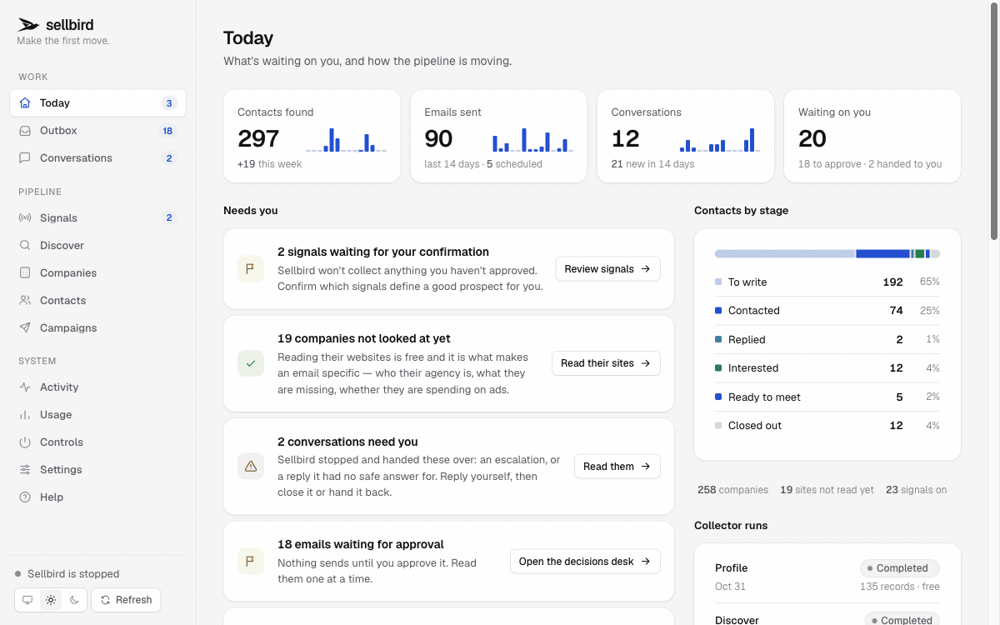

<p align="center">
  <a href="https://sellbird.ai">
    <picture>
      <source media="(prefers-color-scheme: dark)" srcset="docs/brand/sellbird-wordmark-white.svg">
      
    </picture>
  </a>
</p>

<p align="center"><strong>The open-source outreach platform that runs on your Claude or ChatGPT plan.</strong></p>

<p align="center">
Sellbird finds companies that need what you sell, finds the person who decides, checks their email address, writes each one a personal cold email, sends it and handles the replies.
It runs on your own machine, and by default nothing goes out until you approve it.
</p>

<p align="center">
  <a href="https://github.com/ethanplusai/sellbird/stargazers"></a>
  <a href="https://github.com/ethanplusai/sellbird/actions/workflows/tests.yml"></a>
  <a href="LICENSE"></a>
  
  <a href="https://sellbird.ai"></a>
  <a href="#upgrading-from-harvey"></a>
</p>

> **Harvey is now Sellbird.** Same project, same history, new name. Already running Harvey? Your setup carries over: see [Upgrading from Harvey](#upgrading-from-harvey).

**Prefer not to run it yourself? [sellbird.ai](https://sellbird.ai) is the hosted version, with sending domains, inboxes and warmup set up for you. It's in early access.**



<sub>The demo data is invented: "Bookwell" selling online booking to roofers, dental practices and HVAC shops, on `.test` domains.</sub>

## What it does

Sellbird is a pipeline you can run end to end, or stop at any step.

| | What happens | More |
|---|---|---|
| **Find companies** | Searches for businesses that match your customer: free on OpenStreetMap, or on a paid source you pick. Every paid search shows its cost before it runs. | [Discovery](docs/signals-and-pipeline.md#1-discover--who-exists) |
| **Learn why they'd buy** | Reads each company's own website for the buying signals you confirmed, like no online booking, ads running or a role they're hiring for. No model calls, no cost. | [Signals](docs/signals-and-pipeline.md) |
| **Find who decides** | Finds the owner or manager named on the company's own pages, two people per company at most. | [Enrich](docs/signals-and-pipeline.md#3-enrich--who-decides) |
| **Check the address** | Learns the company's email pattern and verifies one address. Every address is marked verified, risky, guess or invalid, and only deliverable ones are ever sent to. | [Verify](docs/signals-and-pipeline.md#4-verify--can-you-reach-them) |
| **Write and send** | Writes a short sequence for each person from what it found, then sends from your Gmail, Microsoft 365 or SMTP mailbox inside your daily limit and their office hours. | [Sending](docs/approval-and-sending.md) |
| **Handle replies** | Reads every reply, drafts an answer, sets auto-replies aside, honours opt-outs at once, and hands you anything it shouldn't answer alone. | [Dashboard](docs/dashboard.md) |

Only want the list? Stop after verifying and run `sellbird export` for a sequencer-ready CSV of everything it found.

```
$ sellbird run

============================================================
Sellbird is online.
============================================================
Checking pipeline state...
Decision: write_campaign (3 new prospects with no drafts)
  handler   → Elena Park, Harbor Dental Studio     interested, answer drafted
  handler   → Priya Nair, Highline Roofing         objection, answer drafted
  writer    → 2-email sequence: Phoenix HVAC hiring a dispatcher
  outbox    → 5 emails waiting for your approval
Cycle complete. Sleeping for 15 minutes.
```

## No model API bill

Sellbird thinks through the Claude Code CLI on your Claude Pro or Max plan, or through Codex on a ChatGPT plan. There's no API key and no per-token billing, and Sellbird throttles itself to leave room for your own work.

| | |
|---|---|
| Claude Pro or Max, or a ChatGPT plan with Codex | the subscription you already have |
| Finding businesses | **$0** on the default source, or about $0.37 per 1,000 on the cheapest paid one |
| Reading their websites | **$0**: three HTTP requests each, no model call |
| Writing and sending | your subscription and a mailbox (about $7 a month for Google Workspace) |
| Prospecting tools | **None.** No Apollo, ZoomInfo, Clearbit or Clay. |

How the loop, the budget and the isolation work: [How Sellbird works](docs/how-it-works.md).

## Quick start

You need:

- **Python 3.11 or newer.** macOS ships 3.9, so run `brew install python@3.13` first if `python3 --version` says so.
- **Claude Pro or Max** with the CLI signed in (`claude login`), or a **ChatGPT plan with the Codex CLI** ([Codex setup](docs/codex.md)).
- **A mailbox to send from**, ideally Google Workspace on a separate sending domain. [Microsoft 365](docs/microsoft365.md) and SMTP work too.
- **Warmup on that mailbox.** We recommend [TrulyInbox](https://trulyinbox.com/?via=sellbird): it warms a new mailbox before cold email and keeps it out of spam after, and Sellbird reads its inbox rate to tell you when you're ready.

### Let Claude set it up

```bash
git clone https://github.com/ethanplusai/sellbird.git
cd sellbird
claude
```

Then say **"set up Sellbird for me"**. The repo's `CLAUDE.md` turns Claude Code into the setup guide: it checks where you are, installs what's missing, asks what it needs and trains Sellbird on your product.

### Or do it yourself

```bash
# 1. Install. Use python3.13, not python3: on macOS bare python3 is 3.9.
python3.13 -m venv .venv && source .venv/bin/activate && pip install -e .

# 2. Add credentials. Every variable is documented inline.
cp .env.example .env && $EDITOR .env

# 3. Learn your product from your website (writes sellbird.local.yaml).
sellbird train https://your-company.com

# 4. Confirm what makes a good prospect.
sellbird signals --confirm free

# 5. Find businesses. The default source is free and needs no account.
sellbird discover

# 6. Open the dashboard and start the loop.
sellbird dashboard          # prints a private link to http://127.0.0.1:5555
sellbird run
```

On Linux you can also [run it with Docker](docs/docker.md).

## Nothing sends without you

Every outgoing email waits in the Outbox for your approval until you turn on autopilot yourself. Before anything leaves, a pre-send check with no model involved rejects unfilled merge tags, banned phrases, overlong emails, extra links and undeliverable addresses. Autopilot still holds back any email that links to a domain that isn't yours or quotes Sellbird's own instructions. `sellbird sending pause` stops everything at once.

Details: [Approval and sending](docs/approval-and-sending.md) and [Legal and deliverability](docs/deliverability.md).

## Upgrading from Harvey

Harvey was renamed Sellbird in 0.4.0. Your configuration, data and dashboard sign-in carry over:

```bash
git pull
pip install -e .        # once, to get the new `sellbird` command
sellbird dashboard
```

- On first run Sellbird renames `harvey.local.yaml` to `sellbird.local.yaml` and `data/harvey.db` (and its log) to `data/sellbird.*`. It never overwrites a file that already exists under the new name, and waits if a Harvey process is still running from the folder. Stop that first.
- `HARVEY_*` environment variables still work when the `SELLBIRD_*` one isn't set; rename them when convenient.
- The `harvey` command and `python -m harvey` still work for now and say they moved. They will be removed in a later release.
- If you edited the tracked `harvey.yaml` directly, `git pull` stops with "your local changes would be overwritten". Run `git stash`, `git pull`, then `git stash pop`. Git carries your edits into `sellbird.yaml`. If it reports a conflict there, keep your lines, delete the conflict markers, and run `git stash drop`. Better still, put your settings in `sellbird.local.yaml`, which git never touches.
- Docker: the service is now `sellbird`. Run `docker compose down`, `git pull`, `docker compose build`, then `docker compose up -d`. `HARVEY_UID`/`HARVEY_GID` are still read.

Links to `github.com/ethanplusai/harvey` keep working: GitHub redirects them here.

## Documentation

| Guide | What's in it |
|---|---|
| [How Sellbird works](docs/how-it-works.md) | The heartbeat loop, the subscription budget, project structure and the ideas behind it |
| [Signals and the prospecting pipeline](docs/signals-and-pipeline.md) | The 29 signals, cohorts, and the discover, profile, enrich and verify stages |
| [Skills and sub-agents](docs/skills-and-agents.md) | The editable sales playbooks and which agent uses which |
| [Approval and sending](docs/approval-and-sending.md) | The Outbox, autopilot, office hours and email signatures |
| [The dashboard and the data](docs/dashboard.md) | Every screen, how sign-in works, and how the data is stored |
| [Configuration and commands](docs/configuration.md) | `.env`, `sellbird.yaml` and every command |
| [Using a ChatGPT plan (Codex)](docs/codex.md) | Running on Codex instead of Claude |
| [Legal and deliverability](docs/deliverability.md) | The rules you're sending under, and warmup |
| [Microsoft 365](docs/microsoft365.md) · [Precleared](docs/precleared.md) | Provider setup guides |
| [Docker](docs/docker.md) · [Troubleshooting](docs/troubleshooting.md) · [Roadmap](docs/roadmap.md) | Running, fixing and what's next |

## Contributing

Pull requests are welcome. Read [CONTRIBUTING.md](CONTRIBUTING.md) first: it covers keeping real contact data out of the repo, test email, and signing off your commits. Found a security problem? Follow [SECURITY.md](SECURITY.md) instead of opening an issue.

See [CHANGELOG.md](CHANGELOG.md) for what changed in each release.

## License

Sellbird is licensed under the [GNU Affero General Public License v3.0](LICENSE). Harvey releases up to 0.3.x were released under MIT, and that code keeps its MIT notice in [NOTICE](NOTICE).

TrulyInbox links in this project are affiliate links: the maintainer may earn a commission, at no extra cost to you.
